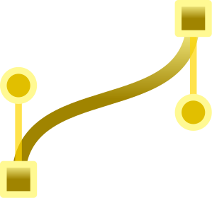

  

# Bezier Line

BezierLine draws a thick cubic Bézier ribbon between two scene objects with a runtime `MeshBuilder`. It supports axis-based handles, explicit control objects, attachment offsets, camera-facing ribbons and world-space curve sampling. The optional Whiteboard-style example adds movable cards, anchor dots, animated flow markers and a UIKit control panel.

The core script imports no companion package. The examples use InteractionKit and UIKit. Read the preserved [setup guide](Docs/guide.md) for the full tutorial and Whiteboard mapping.

## Usage

This section ships with the package and describes the exact installed revision represented by the sources below. Generic Lens scripting, scene construction and Specs spatial design are out of scope here; this package owns its API names, wiring and limitations.

### Package identity

- Descriptor: [package.native](package.native) (holds the package version). Its `ReadMe` continues to reference this README; it has no automatic setup script or instantiable root.
- Editable source folder in this sample: `Assets/BezierLine/`. Consumer import prefix after package installation: `BezierLine.lspkg/`, for example `BezierLine.lspkg/Scripts/BezierLine`.
- Core entry point: [Scripts/BezierLine.ts](Scripts/BezierLine.ts).
- Companion dependencies declared in [package_dependencies.json](package_dependencies.json): InteractionKit and UIKit (plus Motion and Icons, which UIKit needs). Only the example and `Example/` demo scripts import them; the core `Scripts/BezierLine.ts` has no package imports.
- Demo prefab: [BezierLine__PLACE_IN_SCENE.prefab](BezierLine__PLACE_IN_SCENE.prefab). It is self-contained: dropped into a Specs scene with the InteractionKit prefab it brings the `Guide` panel, the `ExampleCarousel` panel and the `BezierDemo` group (board + control panel). The board and control panel stay hidden until the guide's "Ok, I understood" is pressed.
- Demo scaffolding: `BezierLine.lspkg/Example/` holds the scripts only the demo uses (`ExampleCarousel/`, `GuideDismissPanel/`). Don't import them from your own code; delete `Guide` and `ExampleCarousel` from the prefab instance when you build your own Lens. See [components](Docs/components.md#demo-scaffolding-example).

### Version and API status

Read [API status](Docs/api-status.md) before adapting code from another revision. No deprecation or removal markers appear in these package sources. Dependency compatibility still requires a compile check in the consuming project.

### Applicability

Use this package for a thick curved connector between scene objects, or for sampling a cubic curve to place markers. The card/anchor/board classes are an optional interactive example, not a persistence or shared-board system. Use the core alone when you already own endpoint objects and interaction.

### Package Docs (ship in Docs/)

- [Cheat sheet](Docs/cheat-sheet.md): read first for required wiring and rebuild rules.
- [API status](Docs/api-status.md): check revision, compatibility and known source gaps.
- [Components](Docs/components.md): exact inputs, public methods, types and events.
- [Examples](Docs/examples.md): minimal factory code and prefab setup.
- [Troubleshooting](Docs/troubleshooting.md): missing ribbons, stale curves and example behavior.
- [Guide](Docs/guide.md): original long tutorial, usage options and implementation notes.

### Verification

The documentation was checked against this package's TypeScript, prefab and descriptor, and the demo was exercised in the Lens Studio Preview with InteractionKit and UIKit: card drag, dot-to-dot connect (including pair replacement), tap-to-clear, the Width slider, the Flow switch in both directions, the Camera and Debug switches, and Add card / Clear / Reset (Curve and Segments sliders were not dragged). Device behavior (far-field hand rays, comfort) was not verified. Before accepting a consuming project:

1. Compile the core and example imports against the installed companion packages; avoid adding `as any` to consumer snippets to hide errors.
2. Move and rotate both endpoints, switch between axis and explicit controls, then change width/segments with `markDirty()` and inspect the resulting ribbon.
3. Instantiate the demo in a Specs scene with the InteractionKit prefab. Confirm three starter cards and three connectors; drag a card and connect or tap its anchor dots.
4. Exercise Width, Curve, Segments, Camera, Flow and Debug controls, plus Add card, Clear and Reset. Check connection-count events and sample flow markers at two timestamps.
5. Inspect camera-facing behavior, material visibility and logs. Keep missing live Preview/device evidence explicit.

## Support

See the [Specs Developer Community](https://developers.specs.com) and Specs design documentation.

## Built with 👽 by the SPECS team <!-- -->

---

[See more packages](https://github.com/specs-devs/packages)
